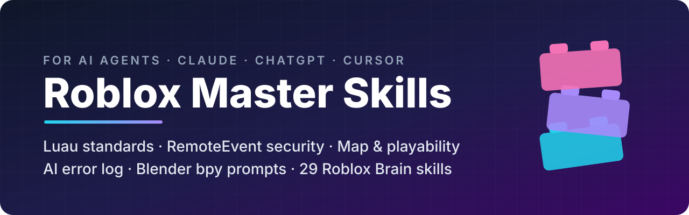

<div align="center">



# 🎮 Roblox Master Skills

**Roblox ও গেম ডেভেলপমেন্টের জন্য AI এজেন্টদের একটি ইউনিভার্সাল স্কিল ও নিয়মের ভাণ্ডার**

Claude, ChatGPT, Cursor বা যেকোনো AI কোডিং এজেন্টকে এক ধাপে একজন অভিজ্ঞ Roblox ডেভেলপারে পরিণত করুন।

<p>
  
  
  
</p>
<p>
  
  
  
</p>

**[🚀 শুরু করুন](#-কীভাবে-ব্যবহার-করবেন)** ·
**[🗂️ ফোল্ডার কাঠামো](#️-ফোল্ডার-কাঠামো)** ·
**[📚 মূল ফাইল](#-মূল-ফাইলগুলোর-পরিচয়)** ·
**[🧰 সহায়ক টুলস](#-সহায়ক-অফিসিয়াল-টুলস)**

</div>

---

## 📖 এই রিপোজিটরি কী?

AI দিয়ে Roblox গেম বানাতে গেলে প্রায়ই একই ভুল বারবার হয় — ক্লায়েন্টের পাঠানো দাম বিশ্বাস করা, পুরনো `wait()` ব্যবহার করা, এমন লাফ বানানো যা আসলে পার হওয়া যায় না, কিংবা প্লেয়ারের সেভ ডেটা হারিয়ে ফেলা।

এই রিপোজিটরি সেই সমস্যার সমাধান। এখানে আছে:

- **নির্দিষ্ট নিয়মাবলি** (`core-rules/`) — Luau কোডিং, RemoteEvent নিরাপত্তা, ম্যাপ বানানোর মাপজোখ, আর AI-এর পুরনো ভুলের তালিকা।
- **প্রম্পট টেমপ্লেট** (`ai-prompts/`) — ছবি তৈরি আর Blender `bpy` স্ক্রিপ্ট দিয়ে 3D অ্যাসেট বানানোর জন্য।
- **Roblox Brain এর লোকাল কপি** (`roblox-brain-local/`) — ২৯টি গভীর স্কিল, চারটি লাইব্রেরিতে ভাগ করা।
- **একটি মাস্টার প্রম্পট** (`UNIVERSAL-BOOTSTRAP.md`) — যা যেকোনো AI-কে বলে দেয় কোন ফাইল কখন পড়তে হবে।

> ℹ️ **ভাষা নিয়ে একটি কথা:** এই README মানুষের জন্য, তাই বাংলায়। AI এজেন্টদের জন্য লেখা সব টেকনিক্যাল ফাইল ইংরেজিতে, যাতে কোনো মডেল অনুবাদের ভুল ছাড়াই সেগুলো ঠিকভাবে বুঝতে ও মানতে পারে।

---

## 🗂️ ফোল্ডার কাঠামো

```
roblox-master-skills/
├── README.md                              ← আপনি এখন এটা পড়ছেন (বাংলা)
├── UNIVERSAL-BOOTSTRAP.md                 ← AI এজেন্টের মাস্টার প্রম্পট
├── core-rules/
│   ├── luau-coding-standards.md           ← Luau নিয়ম, RemoteEvent নিরাপত্তা, DataStore
│   ├── map-building-and-playability.md    ← গ্রিড, প্লেয়ারের জায়গা, লাফের মাপ
│   └── ai-error-log-and-donts.md          ← AI-এর ভুলের লগ ও নিষেধাজ্ঞা
├── ai-prompts/
│   └── image-and-3d-asset-prompts.md      ← ইমেজ জেনারেশন ও Blender bpy প্রম্পট
├── CLAUDE.md / AGENTS.md                  ← কোন কাজে কোন স্কিল, এজেন্ট নিজে থেকে পড়ে
├── skills/
│   ├── model-reference-sheet/             ← মডেলের রেফারেন্স শিট ইমেজের প্রম্পট বানানোর স্কিল
│   └── third-party/                       ← Ponytail, Superpowers, Impeccable, UI UX Pro Max (শুধু স্কিল অংশ)
└── roblox-brain-local/                    ← Roblox Brain (MIT লাইসেন্স) এর লোকাল কপি
    └── skills/
        ├── core/        (১০টি স্কিল)
        ├── gameplay/    (১০টি স্কিল)
        ├── design/      (৫টি স্কিল)
        └── tools/       (৪টি স্কিল)
```

---

## 🚀 কীভাবে ব্যবহার করবেন

### ধাপ ১: রিপোজিটরি ক্লোন করুন

```bash
git clone https://github.com/mrhbijoy/roblox-master-skills.git
```

### ধাপ ২: AI-কে মাস্টার প্রম্পট দিন

`UNIVERSAL-BOOTSTRAP.md` ফাইলটি খুলুন। এর **Section 1**-এর প্রম্পট ব্লকটি কপি করে নতুন AI সেশনের প্রথম মেসেজে পেস্ট করুন। AI নিজেই বাকি ফাইলগুলো সঠিক ক্রমে পড়ে নেবে।

**Claude Code / Cursor এর মতো টুলে** রিপোজিটরি ফোল্ডারটি প্রজেক্টে যোগ করে শুধু বলুন:

```text
Read UNIVERSAL-BOOTSTRAP.md and follow it.
```

### ধাপ ৩: Roblox Brain স্কিল ইনস্টল করুন (ঐচ্ছিক)

স্কিলগুলো সরাসরি এজেন্টের স্কিল ফোল্ডারে কপি করতে পারেন। পুরো স্কিল ফোল্ডারটিই কপি করবেন, শুধু `SKILL.md` নয়:

```bash
cp -r roblox-brain-local/skills/core/roblox-security ~/.claude/skills/
```

অথবা অফিসিয়াল সোর্স থেকে সর্বশেষ সংস্করণ:

```bash
npx skills add TabooHarmony/roblox-brain
```

### ধাপ ৪: ভুলের লগ সচল রাখুন

AI কোনো ভুল করলে এবং আপনি তা শুধরে দিলে, AI-কে বলুন সেটি `core-rules/ai-error-log-and-donts.md`-তে লিখে রাখতে। এভাবে প্রতিটি নতুন সেশন আগের ভুল থেকে শিখবে।

---

## 📚 মূল ফাইলগুলোর পরিচয়

| ফাইল | কী আছে |
| :-- | :-- |
| `UNIVERSAL-BOOTSTRAP.md` | AI কোন ফাইল কোন ক্রমে পড়বে, কাজের ধাপ, আর আউটপুটের নিয়ম |
| `core-rules/luau-coding-standards.md` | `--!strict`, ফোল্ডার কাঠামো, RemoteEvent ভ্যালিডেশন ও রেট-লিমিট, DataStore রিট্রাই, মেমরি লিক প্রতিরোধ |
| `core-rules/map-building-and-playability.md` | ৪-স্টাড গ্রিড, দরজা ও করিডোরের মাপ, লাফের দূরত্ব, প্লেটেস্ট চেকলিস্ট |
| `core-rules/ai-error-log-and-donts.md` | স্থায়ী নিষেধাজ্ঞা আর তারিখসহ ভুলের লগ |
| `ai-prompts/image-and-3d-asset-prompts.md` | আইকন, থাম্বনেইল, টেক্সচারের প্রম্পট; Blender স্ক্রিপ্ট ও FBX এক্সপোর্ট |
| `skills/model-reference-sheet/` | মডেলের নাম বললেই এক পাতার রেফারেন্স শিটের প্রম্পট: হিরো রেন্ডার, চার দিকের ভিউ, অংশের নাম, ক্লোজ-আপ আর রঙের হেক্স কোড। ব্যবহার: `/model-reference-sheet একটা কাঠের ট্রেজার চেস্ট` |

---

## 🧰 সহায়ক অফিসিয়াল টুলস

এই টুলগুলো আলাদা প্রজেক্ট, এই রিপোজিটরির অংশ নয়। দরকার হলে তাদের অফিসিয়াল সোর্স থেকে ইনস্টল করুন:

| টুল | কাজ | লিংক |
| :-- | :-- | :-- |
| 🐴 **Ponytail** | AI এজেন্টের জন্য সহায়ক টুল | [github.com/DietrichGebert/ponytail](https://github.com/DietrichGebert/ponytail) |
| ⚡ **Superpowers** | ব্রেইনস্টর্মিং, পরিকল্পনা, TDD, ডিবাগিংয়ের মতো কাজের ধারার স্কিল | [github.com/obra/superpowers](https://github.com/obra/superpowers) |
| ✨ **Impeccable** | ফ্রন্টএন্ড ও UI ডিজাইনের মান উন্নত করার স্কিল | [github.com/pbakaus/impeccable](https://github.com/pbakaus/impeccable) |
| 🎨 **UI UX Pro Max** | UI/UX ডিজাইন স্টাইল, রঙ, টাইপোগ্রাফি ও UX নিয়ম | [github.com/nextlevelbuilder/ui-ux-pro-max-skill](https://github.com/nextlevelbuilder/ui-ux-pro-max-skill) |
| 🧠 **Roblox Brain** | Roblox Studio-র ২৯টি স্কিল (`roblox-brain-local/` এর মূল সোর্স) | [github.com/TabooHarmony/roblox-brain](https://github.com/TabooHarmony/roblox-brain) |

---

## 🤝 অবদান রাখুন

- নতুন নিয়ম যোগ করতে `core-rules/`-এ ইংরেজিতে লিখুন।
- AI-এর নতুন ভুল পেলে `ai-error-log-and-donts.md`-এর টেমপ্লেট মেনে লগ করুন।
- `roblox-brain-local/` আপডেট করতে অফিসিয়াল Roblox Brain রিপো থেকে নতুন সংস্করণ নিন।

---

## 📜 লাইসেন্স ও কৃতজ্ঞতা

`roblox-brain-local/` ফোল্ডারের কনটেন্ট [TabooHarmony/roblox-brain](https://github.com/TabooHarmony/roblox-brain) থেকে নেওয়া, যা **MIT লাইসেন্সের** অধীন। মূল লাইসেন্স `roblox-brain-local/LICENSE`-এ রাখা আছে।

<div align="center">

**Happy Building! 🧱**

</div>
